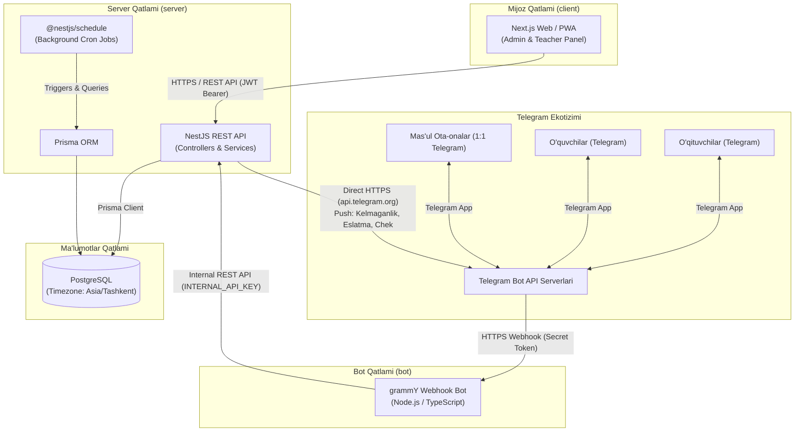
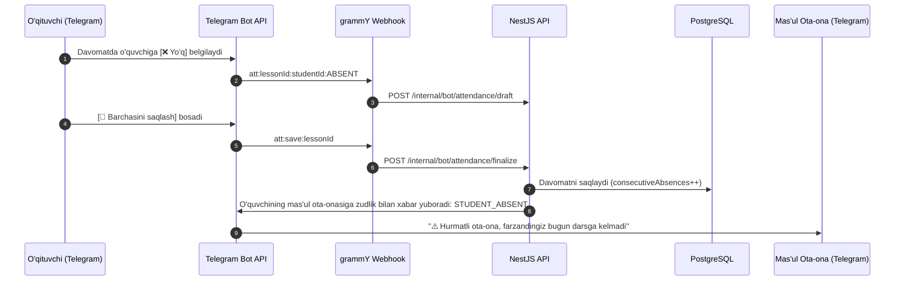
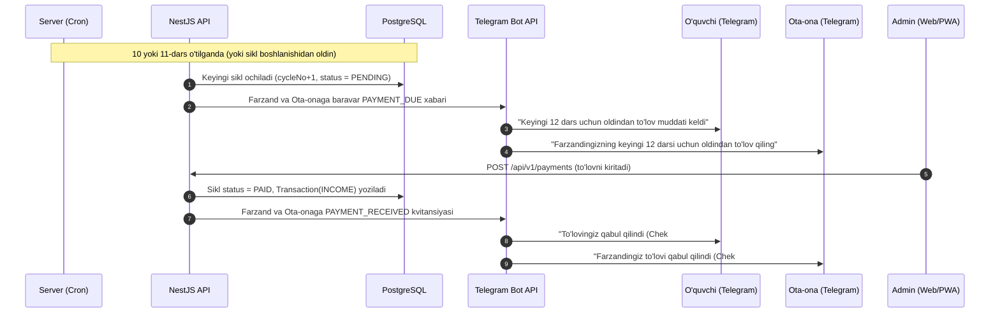

# 01. Tizim Arxitekturasi va Umumiy Ko‘rinish

Ushbu hujjatda **Edu Center** axborot tizimining umumiy arxitekturasi, tarkibiy qismlari, ular o‘rtasidagi aloqa protokollari va tizim integratsiyasi bayon etilgan.

---

## 1. Umumiy Arxitektura Diagrammasi

Tizim bitta Git repozitoriyasida joylashgan bo‘lib, 3 ta mustaqil modullardan (`client`, `server`, `bot`) va yagona PostgreSQL ma’lumotlar bazasidan tashkil topgan:

---

## 2. Asosiy Aloqa va Biznes Oqimlari

### 2.1. Davomat va Kelmaganlik Xabari Oqimi (Immediate Absence Alert)

### 2.2. Oldindan To‘lov (Prepay) Oqimi

---

## 3. Komponentlararo Aloqa Qoidalari

1. **Client → Server**: REST API, JWT Bearer token orqali. Admin barcha markazni, o‘qituvchi esa faqat o‘z kurs va guruhlarini ko‘radi.
2. **Bot → Server**: Maxfiy `INTERNAL_API_KEY` orqali. Telegramdagi harakatlar server biznes mantiqiga xavfsiz uzatiladi.
3. **Server → Telegram**:
   - Darsga kelmaganda ota-onaga zudlik bilan ogohlantirish.
   - Oldindan to‘lov eslatmasi (farzandga ham, uning bitta mas'ul ota-onasiga ham).
   - Darsdan 15 min oldingi eslatmalar.
4. **Foydalanuvchi-Ota-ona munosabati**:
   - Har bir o‘quvchiga faqat bitta ota-ona hisobi bog‘lanadi.
   - Bitta ota-onada bir nechta farzand bo‘lsa, to‘lov eslatmalari bitta umumiy xabarga jamlanadi.
