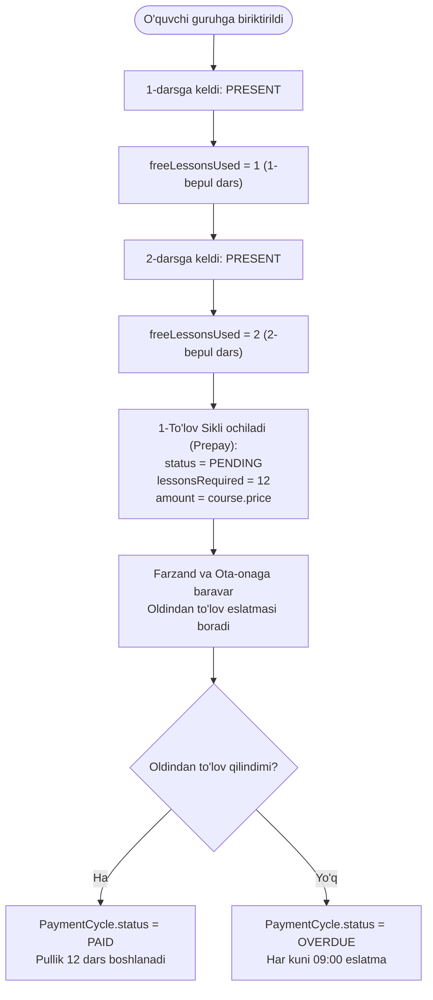
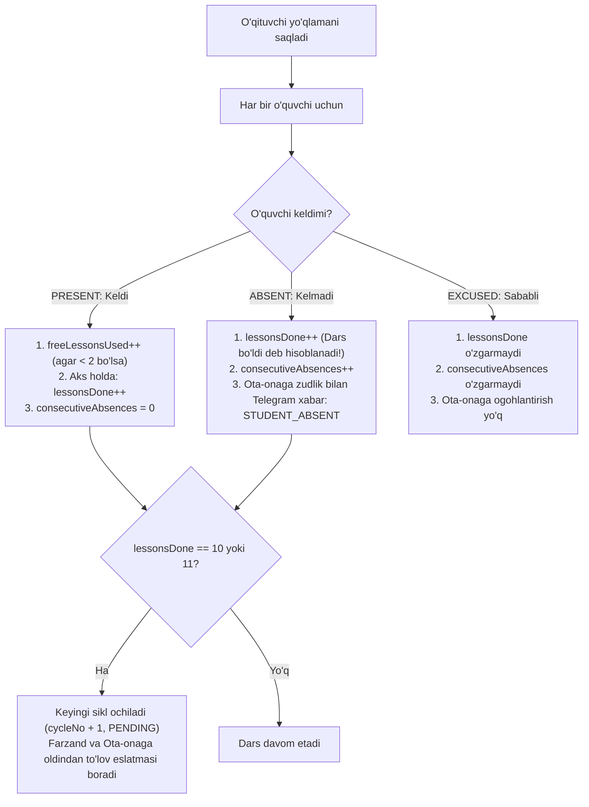

# 03. Biznes Qoidalar va Algoritmlar (Business Logic & Rules)

Ushbu hujjatda **Edu Center** tizimidagi darslar hisobi, davomat oqibatlari, **oldindan to‘lov (Prepay)** modeli, darsga kelmaganda ota-onaga zudlik bilan xabar yuborish, kelsa va kelmasa ham dars bo‘ldi deb hisoblanishi, o‘qituvchini admin paneldan Telegram ID orqali qo‘shish va botda avtomatik o‘quvchi roli hamda ota-ona kontaktini ulashish qoidalari bayon etilgan.

---

## 1. Asosiy Biznes Qoidalar (v1.4)

1. **O‘qituvchini qo‘shish va aniqlash**:
   - O‘qituvchi Admin tomonidan veb-paneldan **Telegram ID** si bilan birga kiritiladi.
   - Ushbu Telegram ID dan botga xabar yozilganda, tizim uni darhol **O‘qituvchi (`TEACHER`)** deb taniydi (kontakt so‘ralmaydi).
2. **Botda avtomatik O‘quvchi roli va Ota-ona kontaktini ulashish**:
   - Botga `/start` bosgan yangi foydalanuvchi roli avtomatik ravishda **O‘quvchi (`STUDENT`)** bo‘ladi.
   - O‘quvchi ro‘yxatdan o‘tishda o‘z raqamini yuboradi va unga **ota-onasining kontaktini ulashish** tugmasi taqdim etiladi.
   - Tizimda har bir o‘quvchiga aynan bitta mas'ul ota yoki ona biriktiriladi (`Student.parentId`).
3. **Oldindan to‘lov (Prepay)**: Har bir 12 darslik to‘lov sikli o‘sha darslar boshlanishidan oldin to‘lanadi.
4. **Kelsa va kelmasa ham dars bo‘ldi deb hisoblanadi**:
   - Dars o‘tgach, o‘quvchi kelgan bo‘lsa (`PRESENT`) ham, kelmagan bo‘lsa (`ABSENT`) ham dars o‘tildi deb qayd etiladi va 12 darslik sikldan 1 dars sarflanadi (`lessonsDone++`). Sababi o‘quvchining o‘rni band qilingan.
5. **Darsga kelmaganda ota-onaga zudlik bilan xabar**: O‘quvchiga davomatda `ABSENT` (Kelmadi) qo‘yilgan soniyadayoq ota-onaning Telegramiga xabar yuboriladi.
6. **Dars boshlanganda yo‘qlama xabari**: Guruh jadvali bo‘yicha dars vaqti kelganda o‘qituvchining Telegramiga **"Yo‘qlamani boshlash"** tugmasi boradi.
7. **2 ta bepul sinov darsi**: O‘quvchi kelgan dastlabki 2 ta dars bepul hisoblanadi. Shundan so‘ng 12 darslik to‘lov oldindan talab qilinadi.
8. **Ikki tomonlama ogohlantirish**: To‘lov eslatmalari bir vaqtning o‘zida **farzandga ham, uning bitta mas'ul ota-onasiga ham** yetkaziladi.
9. **O‘qituvchi veb dashboardi**: O‘qituvchi o‘z panelida guruhlar ro‘yxatini ko‘radi, guruhga kirganda o‘quvchilar ro‘yxati chiqadi, o‘quvchi ustiga bosilganda uning to‘liq ma'lumotlari va darslar bo‘yicha davomat tarixi ochiladi.

---

## 2. O‘qituvchi va O‘quvchi Onboarding Oqimi

### 2.1. O‘qituvchi (Teacher)
- Admin veb-panelda (`/admin/users`) o‘qituvchini yaratadi:
  - Ismi, telefon raqami, paroli (veb-panel uchun) va **Telegram ID**.
- O‘qituvchi Telegram botga `/start` yozganida, bot uning Telegram ID sini bazadagi `User.telegramId` bilan solishtiradi.
- Mos kelsa — darhol o‘qituvchi menyusi ochiladi (`/guruhlarim`, `/davomat`).

### 2.2. O‘quvchi va Mas'ul Ota-ona (Student & Parent)
- Bazada yo‘q yangi foydalanuvchi `/start` bosganda:
  - Roli avtomatik **O‘quvchi** bo‘ladi.
  - 1-bosqich: O‘quvchi `[📱 O‘z telefon raqamimni yuborish]` tugmasini bosadi.
  - 2-bosqich: `[👨‍👩‍👦 Ota-onam kontaktini ulashish]` tugmasi chiqadi. O‘quvchi ota yoki onasining kontaktini yuboradi.
  - Serverda `Student` va `Parent` yozuvlari bog‘lanadi (`Student.parentId = parent.id`).
  - Ota-ona keyinchalik botga kirsa, uning telefoni orqali barcha farzandlari avtomatik ko‘rinadi.

---

## 3. 2 Bepul Sinov Darsi va Oldindan To‘lov Sikli

1. O‘quvchi qatnashgan dastlabki **2 ta `PRESENT`** darsi bepul hisoblanadi (`freeLessonsUsed = 2`).
2. 2-sinov darsi tugashi bilanoq, tizim 1-to‘lov siklini (`cycleNo = 1`, `status = PENDING`) ochadi va keyingi 12 ta dars uchun to‘lovni **oldindan to‘lashni** so‘raydi.
3. Agar o‘quvchi darsga kelmasa (`ABSENT`), sinov darsi sarflanmaydi, lekin **ota-onasiga darhol darsga kelmaganlik xabari boradi**.

---

## 4. Davomat: "Kelsa va Kelmasa Ham Dars Bo‘ldi Deb Hisoblanadi"

Dars vaqti yetganda o‘qituvchiga botdan "Yo‘qlamani boshlash" xabari boradi. O‘qituvchi yo‘qlamani saqlaganida:

### Davomat qoidalari:
1. **`PRESENT` (Keldi)**:
   - Dars hisoblagichi oshadi (`lessonsDone++`). Ketma-ket dars qoldirish nolga tenglashadi (`consecutiveAbsences = 0`).
2. **`ABSENT` (Kelmadi)**:
   - **Dars hisoblanadi**: O‘quvchi darsga kelmasa ham, uning o‘rni saqlangani va dars o‘tilgani sababli 12 darslik to‘lov siklidan bitta dars sarflanadi (`lessonsDone++`).
   - **Ota-onaga darhol xabar**: Shu soniyaning o‘zida o‘quvchining mas'ul ota-onasiga Telegram bildirishnomasi jo‘natiladi:
     > *"⚠️ Diqqat: Farzandingiz [Student] bugun soat 14:00 dagi [Kurs] darsiga kelmadi."*
   - Ketma-ket kelmaslik hisoblagichi oshadi (`consecutiveAbsences++`). Agar 5 taga yetsa, guruhdan vaqtincha to‘xtatiladi (`SUSPENDED`).
3. **`EXCUSED` (Sababli)**:
   - Markaz ma'muriyati yoki o‘qituvchi bilan kelishilgan holatlarda dars hisoblanmaydi (`lessonsDone` o‘smaydi).

---

## 5. Oldindan To‘lov (Prepay) va Ikki Tomonlama Eslatmalar

1. Har bir to‘lov sikli **12 ta darsni** o‘z ichiga oladi.
2. Sikl tugashiga 1-2 dars qolganda (**10 yoki 11-dars o‘tilganda**):
   - Tizim keyingi to‘lov siklini (`cycleNo + 1`, `status = PENDING`) avtomatik ochadi.
   - **Farzandga ham, uning mas'ul ota-onasiga ham** Telegram orqali oldindan to‘lov eslatmasi (`PAYMENT_DUE`) yuboriladi.
3. **12-dars tugaganda**:
   - Agar to‘lov oldindan qilingan bo‘lsa (`PAID`), keyingi darslar yangi sikl hisobidan davom etadi.
   - Agar to‘lov qilinmagan bo‘lsa, sikl `OVERDUE` ga o‘tadi va har kuni ertalab 09:00 da farzand va ota-onaga qarzdorlik eslatmasi yuboriladi.

---

## 6. O‘qituvchi Veb Dashboardi (Teacher Web Panel)

1. **Guruhlar ro‘yxati (`/teacher/groups`)**:
   - Faqat o‘ziga biriktirilgan faol guruhlar kartalari (nomi, fani, dars jadvali, xona, jami o‘quvchilar soni).
2. **Guruh sahifasi va o‘quvchilar ro‘yxati (`/teacher/groups/:id`)**:
   - Guruh ichiga kirilganda barcha o‘quvchilar ro‘yxati chiqadi.
   - O‘quvchi statusi (faol, to‘xtatilgan), qatnashgan darslari soni (masalan, 8/12).
3. **O‘quvchi profili va to‘liq davomat tarixi (`/teacher/groups/:id/students/:studentId`)**:
   - O‘quvchi ismi ustiga bosilganda uning sahifasi ochiladi:
     - Shaxsiy ma'lumotlari va telefoni.
     - Mas'ul ota yoki onasining ismi va telefoni.
     - **Barcha darslar bo‘yicha to‘liq davomat tarixi**: o‘tilgan har bir dars sanasi va o‘quvchining holati (`✅ Keldi`, `❌ Kelmadi`, `⏸ Sababli`).
