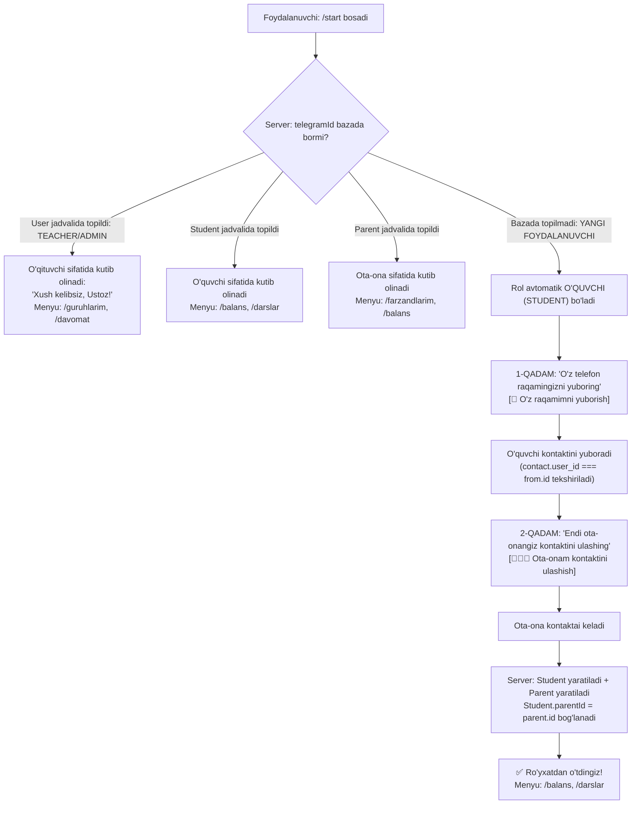

# 05. Telegram Bot Spetsifikatsiyasi (grammY)

Ushbu hujjatda **Edu Center** Telegram boti (`bot` — grammY), o‘qituvchini Telegram ID orqali avtomatik aniqlash, yangi foydalanuvchi `/start` bosganda uning roli avtomatik ravishda **O‘quvchi** bo‘lishi va **ota-ona kontaktini ulashish** oqimi, komandalar va yo‘qlama tizimi bayon etilgan.

---

## 1. Asosiy Qoidalar va Ruxsatlar Matritsasi

- **Til**: **Faqat O‘zbek tilida**.
- **O‘qituvchi identifikatsiyasi**: O‘qituvchi Admin tomonidan veb-paneldan **Telegram ID** si bilan qo‘shiladi. Botga yozganida tizim uning Telegram ID si orqali darhol **O‘qituvchi** ekanligini aniqlaydi (kontakt so‘ralmaydi).
- **Yangi foydalanuvchi roli**: Botga `/start` bosgan yangi foydalanuvchi avtomatik ravishda **O‘quvchi (`STUDENT`)** deb qabul qilinadi.
- **Ota-ona kontaktini ulashish**: O‘quvchi ro‘yxatdan o‘tayotganda o‘z raqamini yuboradi va unga **ota-onasining kontaktini ulashish** tugmasi taqdim etiladi. Tizimda farzandga aynan bitta mas'ul ota yoki ona biriktiriladi.

### 1.1. Komandalar va Ruxsatlar

| Komanda | ADMIN | TEACHER | STUDENT | PARENT | Vazifasi |
| :--- | :---: | :---: | :---: | :---: | :--- |
| `/start` | ✅ | ✅ | ✅ | ✅ | Botni ishga tushirish va identifikatsiya |
| `/balans` | ❌ | ❌ | ✅ | ✅ | To‘lov holati, 12 dars hisobi va qarz |
| `/darslar` | ❌ | ❌ | ✅ | ✅ | Darslar jadvali va davomat tarixi |
| `/guruhlarim`| ❌ | ✅ | ❌ | ❌ | O‘qituvchi guruhlari ro‘yxati |
| `/davomat` | ❌ | ✅ | ❌ | ❌ | Bugungi darslar uchun yo‘qlama |
| `/farzandlarim`| ❌ | ❌ | ❌ | ✅ | Farzandlar davomati va to‘lovlari |

---

## 2. `/start` Oqimi — To‘liq Arxitektura va Mantiq



---

## 3. Bot Handler Kodu (`src/handlers/start.ts`)

```typescript
import { Bot, Keyboard } from "grammy";
import { api } from "../api";

export function registerStart(bot: Bot) {
  // 1. /start komandasi
  bot.command("start", async (ctx) => {
    const telegramId = String(ctx.from?.id);
    if (!telegramId) return;

    // A. Avval Telegram ID bo'yicha tizimdan tekshiramiz
    const user = await api.checkUserByTelegramId(telegramId).catch(() => null);

    // 1-HOLAT: O'qituvchi (Admin paneldan Telegram ID si kiritilgan)
    if (user && user.role === "TEACHER") {
      await ctx.reply(
        `Assalomu alaykum, ${user.name} (O‘qituvchi)!\n\n` +
          `Siz tizimda o‘qituvchi sifatida muvaffaqiyatli aniqlandingiz.\n\n` +
          `Guruhlaringiz: /guruhlarim\n` +
          `Bugungi yo‘qlama: /davomat`,
      );
      return;
    }

    // 2-HOLAT: Allaqachon ro'yxatdan o'tgan O'quvchi
    if (user && user.role === "STUDENT") {
      await ctx.reply(
        `Xush kelibsiz, ${user.name}!\n\n` +
          `Balans va to‘lovlar: /balans\n` +
          `Dars jadvali: /darslar`,
      );
      return;
    }

    // 3-HOLAT: Allaqachon ro'yxatdan o'tgan Ota-ona
    if (user && user.role === "PARENT") {
      await ctx.reply(
        `Assalomu alaykum, ${user.name}!\n\n` +
          `Farzandlaringiz holati: /farzandlarim\n` +
          `To‘lovlar balansi: /balans\n` +
          `Darslar jadvali: /darslar`,
      );
      return;
    }

    // 4-HOLAT: Yangi foydalanuvchi — ROLI AVTOMATIK O'QUVCHI BO'LADI
    // 1-qadam: O'quvchining o'z raqamini so'rash
    const ownKeyboard = new Keyboard()
      .requestContact("📱 O‘z telefon raqamimni yuborish")
      .resized()
      .oneTime();

    // Sessiyada holatni saqlaymiz: STEP_OWN_CONTACT
    ctx.session.step = "AWAITING_STUDENT_CONTACT";

    await ctx.reply(
      "Assalomu alaykum! Edu Center botiga xush kelibsiz.\n\n" +
        "Siz o‘quvchi sifatida ro‘yxatdan o‘tmoqdasiz.\n" +
        "Iltimos, pastdagi tugma orqali o‘z telefon raqamingizni yuboring:",
      { reply_markup: ownKeyboard },
    );
  });

  // 2. Kontakt kelganda (2 bosqichli ro'yxatdan o'tish)
  bot.on("message:contact", async (ctx) => {
    const contact = ctx.message.contact;
    const fromId = ctx.from.id;
    const currentStep = ctx.session.step;

    // 1-BOSQICH: O'quvchi o'z telefon raqamini yubordi
    if (currentStep === "AWAITING_STUDENT_CONTACT") {
      // Xavfsizlik: o'quvchi faqat o'z raqamini yuborishi shart
      if (contact.user_id !== fromId) {
        await ctx.reply(
          "❌ Iltimos, pastdagi [📱 O‘z telefon raqamimni yuborish] tugmasini bosing.",
        );
        return;
      }

      ctx.session.studentPhone = normalizePhone(contact.phone_number);
      ctx.session.studentName = `${ctx.from.first_name} ${ctx.from.last_name ?? ""}`.trim();

      // 2-BOSQICH: Ota-ona kontaktini so'raymiz
      ctx.session.step = "AWAITING_PARENT_CONTACT";

      const parentKeyboard = new Keyboard()
        .requestContact("👨‍👩‍👦 Ota-onam kontaktini ulashish")
        .resized()
        .oneTime();

      await ctx.reply(
        "Rahmat! Endi eslatmalar va to‘lov ma'lumotlari borishi uchun " +
          "ota yoki onangizning kontaktini pastdagi tugma orqali ulashing:\n\n" +
          "(yoki ota-onangizning raqamini +998901234567 ko‘rinishida yozib yuboring)",
        { reply_markup: parentKeyboard },
      );
      return;
    }

    // 2-BOSQICH: Ota-ona kontaktai kelganda
    if (currentStep === "AWAITING_PARENT_CONTACT") {
      const parentPhone = normalizePhone(contact.phone_number);
      const parentName = `${contact.first_name} ${contact.last_name ?? ""}`.trim();

      await finishStudentRegistration(ctx, parentPhone, parentName);
    }
  });

  // Ota-ona raqamini matn sifatida yozib yuborilgan holat
  bot.on("message:text", async (ctx, next) => {
    if (ctx.message.text.startsWith("/")) return next();

    if (ctx.session.step === "AWAITING_PARENT_CONTACT") {
      const rawText = ctx.message.text.trim();
      const parentPhone = normalizePhone(rawText);

      if (!/^\+998\d{9}$/.test(parentPhone)) {
        await ctx.reply("❌ Telefon raqam noto‘g‘ri kiritildi. Namuna: +998901234567");
        return;
      }

      await finishStudentRegistration(ctx, parentPhone, "Ota-ona");
      return;
    }

    return next();
  });
}

// Ro'yxatdan o'tishni yakunlash
async function finishStudentRegistration(ctx: any, parentPhone: string, parentName: string) {
  try {
    const res = await api.registerStudentWithParent({
      studentTelegramId: String(ctx.from.id),
      studentPhone: ctx.session.studentPhone,
      studentName: ctx.session.studentName,
      parentPhone,
      parentName,
    });

    ctx.session.step = null;

    await ctx.reply(
      `🎉 Tabriklaymiz, ${res.studentName}!\n\n` +
        `Siz tizimga muvaffaqiyatli kiritildingiz.\n` +
        `Ota-onangiz raqami (${parentPhone}) biriktirildi.\n\n` +
        `/balans — to‘lovlar balansi\n` +
        `/darslar — dars jadvali`,
      { reply_markup: { remove_keyboard: true } },
    );
  } catch (err: any) {
    await ctx.reply("⚠️ Ro‘yxatdan o‘tishda xatolik yuz berdi. Iltimos, ma'muriyatga murojaat qiling.");
  }
}

function normalizePhone(raw: string): string {
  const digits = raw.replace(/\D/g, "");
  if (digits.length === 12) return `+${digits}`;
  if (digits.length === 9) return `+998${digits}`;
  return `+${digits}`;
}
```

---

## 4. Server Tomoni (NestJS) — O‘qituvchini Aniqlash va O‘quvchi-Ota-onani Saqlash

### 4.1. Telegram ID orqali Foydalanuvchini Tekshirish
- **Endpoint**: `GET /api/v1/internal/auth/check-user/:telegramId`
- **Mantiq**:
```typescript
async checkUserByTelegramId(telegramId: string) {
  // 1. O'qituvchi yoki Admin (Admin paneldan telegramId kiritilgan)
  const user = await this.prisma.user.findUnique({
    where: { telegramId },
    select: { id: true, name: true, role: true }
  });
  if (user) return user;

  // 2. O'quvchi
  const student = await this.prisma.student.findUnique({
    where: { telegramId },
    select: { id: true, name: true, status: true }
  });
  if (student) return { ...student, role: 'STUDENT' };

  // 3. Ota-ona
  const parent = await this.prisma.parent.findUnique({
    where: { telegramId },
    select: { id: true, name: true }
  });
  if (parent) return { ...parent, role: 'PARENT' };

  return null;
}
```

### 4.2. O‘quvchini Ota-onasi Bilan Birga Ro‘yxatdan O‘tkazish
- **Endpoint**: `POST /api/v1/internal/auth/register-student-with-parent`
- **Mantiq**:
```typescript
async registerStudentWithParent(dto: RegisterStudentDto) {
  // 1. Ota-onani qidirish yoki yangi yaratish
  let parent = await this.prisma.parent.findUnique({
    where: { phone: dto.parentPhone }
  });

  if (!parent) {
    parent = await this.prisma.parent.create({
      data: {
        phone: dto.parentPhone,
        name: dto.parentName || "Ota-ona",
      }
    });
  }

  // 2. O'quvchini yaratish yoki mavjud bo'lsa telegramId va parentId ni yangilash
  const student = await this.prisma.student.upsert({
    where: { phone: dto.studentPhone },
    update: {
      telegramId: dto.studentTelegramId,
      name: dto.studentName,
      parentId: parent.id,
      status: StudentStatus.ACTIVE
    },
    create: {
      telegramId: dto.studentTelegramId,
      phone: dto.studentPhone,
      name: dto.studentName,
      parentId: parent.id,
      status: StudentStatus.ACTIVE
    }
  });

  return { studentName: student.name, parentPhone: parent.phone };
}
```

---

## 5. Dars Boshlanganda "Yo‘qlamani Boshlash" Oqimi (O‘qituvchi)

Guruh jadvalidagi dars vaqti yetganda server cron o‘qituvchining `User.telegramId` siga inline tugma yuboradi:

```text
🔔 Dars vaqti bo‘ldi!

📚 Guruh: IELTS Foundation - 1
📖 Kurs: Ingliz tili
📍 Xona: 304 (Davomiyligi: 90 daqiqa)

Iltimos, o‘quvchilar yo‘qlamasini o‘tkazing:
[📋 Yo‘qlamani boshlash]
```

1. **O‘qituvchi [📋 Yo‘qlamani boshlash] tugmasini bosadi**.
2. O‘quvchilar ro‘yxati inline ko‘rinishda chiqadi:
   `[Ali Valiyev]   [✅ Keldi]  [❌ Kelmadi]`
3. `[💾 Barchasini saqlash]` bosilganda:
   - `PRESENT` bo‘lsa ham, `ABSENT` bo‘lsa ham **dars bo‘ldi deb hisoblanadi (`lessonsDone++`)**.
   - `ABSENT` bo‘lgan o‘quvchining tizimdagi mas'ul ota-onasiga zudlik bilan:
     > *"⚠️ Diqqat: Farzandingiz Ali Valiyev bugun soat 14:00 dagi Ingliz tili darsiga kelmadi."*
     xabari yuboriladi.
